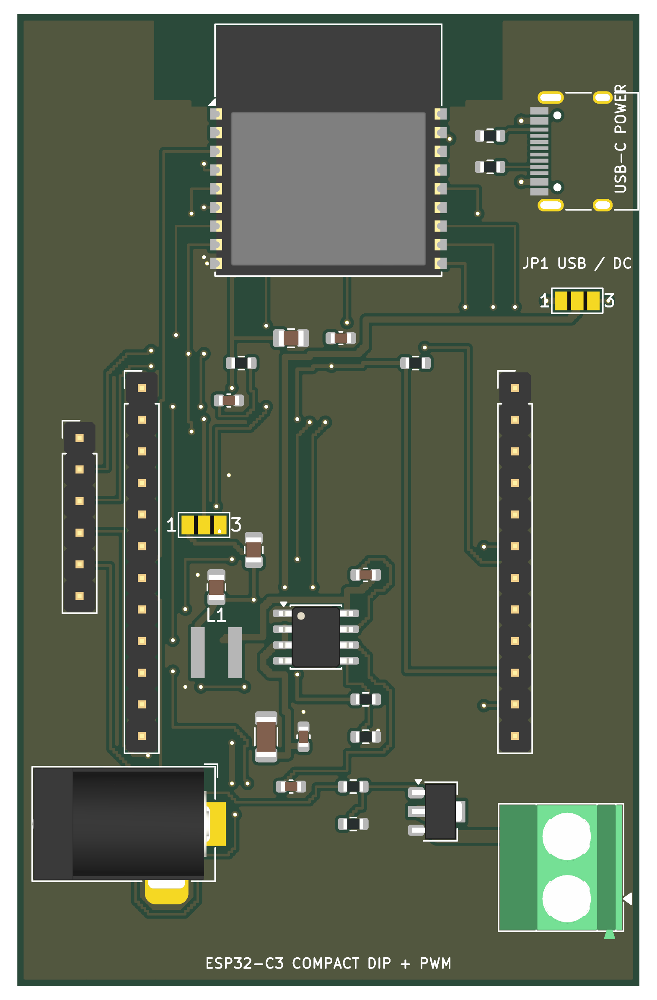

# ESP32-C3 Compact DIP + LED PWM

ESP32-C3-WROOM-02を2.54 mmピッチで引き出し、5/12/24 VのDC入力またはUSB-C 5 Vで動かせる、1チャンネルLED PWM基板です。基板寸法は **50 × 78 mm**。USB-Cは電源専用で、書き込みはM5Stack A105ヘッダから行います。

## 主な仕様

- DCジャック: 5.5/2.1 mm、センタープラス、5～24 V
- USB-C: 5 V電源専用。D+/D-は未接続、CC1/CC2に各5.1 kΩ
- 3.3 V電源: LMR36510（最大入力65 V）による直接降圧
- 降圧インダクタ: 22µH、定格2A、飽和電流3.1Aの低価格モールド品
- JP1: USB 5 VかDC入力を手動選択
- JP2: 基板内3.3 VかA105の3.3 Vを手動選択
- 書き込み: M5Stack A105用6ピン（GND、BOOT、EN、TXD、RXD、3V3）
- LED出力: J3-1がLED+、J3-2がMOSFETでPWMされるLED-
- PWM: GPIO4、N-MOSFET 1チャンネル
- JLCPCBでSMD実装、DCジャック・端子台・ピンヘッダは手はんだ

## 最重要ルール

1. JP1は1-2（USB）または2-3（DC）の片側だけをはんだで接続します。
2. JP2は1-2（内蔵3.3 V）または2-3（A105給電）の片側だけを接続します。
3. DCジャックとUSB-Cを同時に給電しません。
4. A105から給電する時はJP2をA105側にし、DC/USB電源を外します。
5. DCジャックはセンタープラス限定です。本基板に逆接保護・ヒューズ・自動ORingはありません。

詳しい説明は [電源・ジャンパガイド](docs/POWER_AND_JUMPER_GUIDE_JA.md) と [注文前レビュー](ORDER_REVIEW.md) を参照してください。

## 製造ファイル

- `manufacturing/JLCPCB-upload.zip`: PCB製造用Gerber/ドリル一式
- `BOM-JLCPCB.csv`: PCBA用BOM
- `CPL-JLCPCB.csv`: PCBA用部品座標
- `BOM-full.csv`: 手はんだ部品を含む全部品表
- `verification/erc.rpt`: ERC 0件
- `verification/drc.rpt`: DRC 0件、未配線0件

JLCPCBへの注文はまだ行っていません。注文画面で部品在庫、向き、価格を確認してから発注してください。
